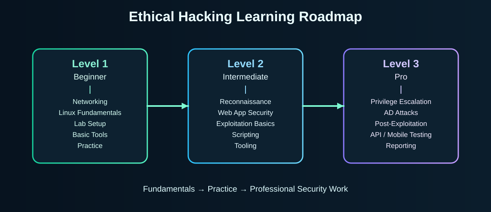

# Ethical Hacking Learning Roadmap (Education Purpose Only)

> **Legal Warning:** Use everything in this repository ONLY on your own lab machines, CTF platforms (TryHackMe, HackTheBox), or programs with written permission (HackerOne, Bugcrowd). Testing systems without explicit permission is illegal.

This repository is a curated, practical learning hub for ethical hacking and penetration testing. It contains a structured roadmap (beginner → intermediate → pro), cheatsheets, tools, and writeups to help you learn safely and effectively.

---

## Visual roadmap (quick overview)

The following diagram shows the progression from ground-level fundamentals (Level 1) through core offensive skills (Level 2) to professional pentesting capabilities (Level 3).

---

## At-a-glance table

| Level | Timeframe | Core focus | Typical topics / deliverables |
|---|---:|---|---|
| Level 1 — Beginner | 0–3 months | Fundamentals / Lab setup | Networking basics, Linux commands, lab VMs, Wireshark, basic Nmap scans |
| Level 2 — Intermediate | 3–9 months | Offensive techniques & tooling | Recon (nmap, subdomain enumeration), OWASP Top10, Burp Suite, exploitation basics, scripting (Python/Bash) |
| Level 3 — Pro | 9+ months | Professional pentesting & reporting | Privilege escalation, AD attacks, post-exploitation, mobile/API testing, reporting & CVSS |

---

## How to use this repo (ground-level, step-by-step)

1. Clone the repo: `git clone https://github.com/kumarmehul181-droid/Hacktricks.git`
2. Start at the README/learning-roadmap and pick a Level to follow sequentially.
3. Set up your lab: install Kali (attacker) and one or more vulnerable targets (Metasploitable, DVWA, Juice Shop). Keep the lab isolated (Host-only or NAT + internal networks).
4. Follow the cheatsheets in `/cheatsheets` for quick commands and workflows. Add your own writeups to `/writeups` after solving machines.
5. Use the `/tools` folder for scripts you build — name them and include a README describing how to use them.

---

## What I added in this change

- assets/logo.svg — lightweight SVG logo used in repo and site header
- assets/roadmap.svg — simple visual diagram showing Levels 1 → 2 → 3
- cheatsheets/cheatsheet.md — quick reference table for commands and tools (see /cheatsheets)
- This README updated to include the visuals and a summary table for ground-level clarity

---

If you want: I can also update `index.html` to embed the same logo/diagram, generate PNG versions of the SVGs for compatibility, or create a more detailed infographic (larger SVG) for printing/presentation. Tell me which of those you'd like next.